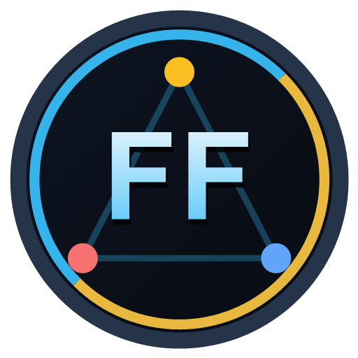

<div align="center">
  
  <h1>ForeverFriends — Squad Hub</h1>
  <p><strong>The All-in-One Squad & Friends Hub for World of Warcraft: Forever (Client 16001)</strong></p>
  <p>
    <em>Shared Inventory, Bank & Alts · Professions & Material Checker · Live Quest Sync · World Map Radar · Group QoL</em>
  </p>
  <p>
    <a href="#overview-english"><strong>English Documentation</strong></a> ·
    <a href="#slash-commands"><strong>Slash Commands</strong></a> ·
    <a href="#github--curseforge-cicd-setup-for-maintainers"><strong>CurseForge CI/CD</strong></a> ·
    <a href="#überblick-deutsch"><strong>Deutsche Dokumentation</strong></a>
  </p>
</div>

---

## Overview (English)

**ForeverFriends [Squad Hub]** connects you, your alts (twinks), and your friend group in **World of Warcraft: Forever** seamlessly in the background — whether you are currently in a party, playing in the same guild, or questing solo across the world.

Built specifically for the modern **WoW: Forever (`Interface: 16001`)** client, it features native support for **two-word character names (`First + Surname`)**, **cross-faction tracking (`[H]` Horde & `[A]` Alliance)**, and a **Zero-Idle-Traffic** synchronization engine.

### Key Features

1. **Shared Inventory, Bank, Alts & Gold Tracker (`Priority 1`)**
   - **Live Item Tooltips:** Hover over any item to immediately see which of your own characters (alts/twinks) or friends have it in their bags, bank, or equipped — complete with class colors and `[H]`/`[A]` faction badges.
   - **Squad Wishlist & Quick-Trade Helper:** Right-click any item to star (`[*]`) it on the shared Squad Wishlist. When opening a trade window with a friend, ForeverFriends automatically displays a 1-click **Quick-Trade Bar** for wishlist items and consumables.
   - **Faction-Separated Gold Summary:** Tracks gold across *You · Friends · `[H]` Horde · `[A]` Alliance · Total*.

2. **Professions, Recipes & 3-Tier Material Availability Checker (`Priority 1`)**
   - **Who Can Craft What?** Browse all learned recipes across your alts and friends in one searchable list and filter by specific professions (*Alchemy*, *Blacksmithing*, *Cooking*, *Engineering*, *Enchanting*, etc.).
   - **3-Tier `Mats-Check` (Reagent Availability):** Automatically scans recipe reagents and checks whether the required materials are available:
     - **Green (`Mats: Nx (Du)`)** — Immediately craftable using materials on your currently active character (bags + bank).
     - **Blue (`Mats: Nx (Twinks)`)** — Craftable using combined materials across your own characters/alts.
     - **Gold (`Mats: Nx (DB/Squad)`)** — Craftable when pooling materials from your entire friend group database.
   - **Detailed Reagent Tooltip:** Hover over any recipe row to see a full breakdown of every required material (`Have / Needed`) and which character holds it.

3. **Live Quest & Leveling Sync (`Priority 2`)**
   - Compare active quests and live objective progress (`3/10`) across your squad in real time.
   - Filter by your current zone and immediately see which same-faction friends are still missing a quest, with 1-click quest sharing.

4. **GuildMap-Style World Radar, `<1s` Death Alerts & Group QoL (`Priority 3`)**
   - **World Map Friend Pins (Solo & Group):** Displays class-colored pins for your active friends directly on the World Map — even when you are not in a party.
   - **Instant (`<1s`) Death / Gank Alerts & SOS Waypoints:** Broadcasts a clickable alert banner with map coordinates when a friend dies or clicks **"SOS Notruf!"**, allowing 1-click waypoint placement via the Direct Fast-Path channel.
   - **Movable Squad Radar HUD & Instance Lockout Tracker:** Compact on-screen HUD showing friend vitals, current zone, and your rolling **5-instances-per-hour lockout counter**.

5. **Global Faction & Character Filter Bar**
   - Filter all tabs simultaneously with a single click by **Faction** (`All`, `[H] Horde`, `[A] Alliance`, `Own Faction`) or by any individual **Character / Alt / Friend** via the header dropdown.

6. **Zero-Idle-Traffic Architecture & Client 16001 Best Practices**
   - **100% Secret Addon-Only Sync:** Uses invisible addon communication channels (`PARTY`, `RAID`, `INSTANCE_CHAT`, `GUILD`, and online-verified `WHISPER`) compressed with `LibSerialize` + `LibDeflate`. Never occupies numbered `/1..10` chat channels!
   - **Content Fingerprint Guard:** Persists content hashes in `SavedVariablesPerCharacter` (`ForeverFriendsCharDB.sentHashes`). Sorting bags, `/reload`, or Blizzard's frequent `QUEST_LOG_UPDATE` events generate **0 network packets** unless actual item counts or quest progress changed.
   - **GuildMap-Style GPS & Native Group Bypass:** Reads party/raid member positions and vitals 100% locally via the WoW API (`0` network packets) and stops all GPS broadcasts when standing still, in combat, or inside instances.
   - **5 Modern UI Themes:** *Obsidian Cyan*, *Emerald Slate*, *Forever Gold*, *Midnight Violet*, and *Crimson Shadow* — freely movable and drag-scalable (`65%–150%`).

---

## Slash Commands

| Command | Description |
| :--- | :--- |
| `/ff` or `/squad` | Toggle the main **ForeverFriends Squad Hub** window |
| `/ff sync` | Force an immediate full state sync with your friends |
| `/ff inv` | Invite all online members of your squad roster to a party |
| `/ff sos [message]` | Broadcast an emergency SOS alert with your current map coordinates |
| `/ff add <First Surname>` | Add a friend to your permanent squad roster |
| `/ff hud` | Toggle the floating **Squad Radar HUD** on or off |
| `/ff config` | Open the **Settings & Customization** tab |
| `/ff reset` | Reset window position and scale back to center |

---

## Installation

1. Download the latest `ForeverFriends.zip` release archive.
2. Extract the `ForeverFriends` folder into your **WoW: Forever** `AddOns` directory:
   ```text
   World of Warcraft\_forever_\Interface\AddOns\ForeverFriends
   ```
   *(Make sure `ForeverFriends.toc` is located directly at `...\Interface\AddOns\ForeverFriends\ForeverFriends.toc` and not nested inside a double `ForeverFriends\ForeverFriends` folder).*
3. Restart the game client (or type `/reload` if updating an existing installation).

---

## GitHub & CurseForge CI/CD Setup (For Maintainers)

This repository is pre-configured for **automated releases to GitHub Releases & CurseForge** using [BigWigsMods/packager](https://github.com/BigWigsMods/packager) (`.github/workflows/release.yml` & `.pkgmeta`).

### 1. Set Your Project ID in `ForeverFriends.toc`
Once you create your project on [CurseForge](https://authors.curseforge.com/), copy your numeric **Project ID** into `ForeverFriends.toc`:
```ini
## X-Curse-Project-ID: 1234567
```

### 2. Add Your CurseForge API Token to GitHub Secrets
1. Generate an API Token on CurseForge at [API Tokens](https://authors.curseforge.com/#/api-tokens).
2. In your GitHub repository, navigate to **Settings** -> **Secrets and variables** -> **Actions** -> **New repository secret**:
   - **Name:** `CF_API_KEY`
   - **Secret:** `<Your CurseForge API Token>`

### 3. Publish a Release via Git Tag
Whenever you push a version tag, GitHub Actions validates all `.toc` paths and Lua 5.1 syntax, builds `ForeverFriends-<version>.zip`, creates a **GitHub Release**, and uploads the package with `CHANGELOG.md` directly to **CurseForge**:
```bash
git tag v1.0.0
git push origin v1.0.0
```
*(You can upload `Media/icon-curseforge.png` directly as your 512×512 CurseForge project avatar!)*

---
---

## Überblick (Deutsch)

**ForeverFriends [Squad Hub]** verbindet dich, deine Twinks und deine Freunde in **World of Warcraft: Forever** automatisch im Hintergrund — egal ob ihr gerade gemeinsam in einer Gruppe seid, in einer Gilde spielt oder solo in der Welt unterwegs seid.

### Hauptfunktionen

1. **Gemeinsames Inventar, Bank, Twinks & Gold (`Prio 1`)**
   - **Live-Bestände im Item-Tooltip:** Sieh sofort beim Überfahren eines Items, wer von deinen eigenen Twinks oder deinen Freunden wie viele davon auf Tasche, Bank oder angelegt hat (inkl. `[H]`/`[A]` Fraktions-Badge).
   - **Wunschliste & Quick-Trade-Helfer:** Markiere gesuchte Items per Rechtsklick mit `[*]` für deine Freunde. Beim Öffnen des Handelsfensters blendet ForeverFriends automatisch eine Schnellleiste zum 1-Klick-Übergeben ein.
   - **Gold-Übersicht:** Aufgeschlüsselt nach *Du · Freunde · `[H]` Horde · `[A]` Allianz · Gesamt*.

2. **Berufe, Rezepte & Automatischer Material-Check (`Prio 1`)**
   - **Wer kann was herstellen?** Durchsuche alle Rezepte deiner Twinks und deiner Freunde an einem Ort und filtere gezielt nach einzelnen Berufen (*Alchemie*, *Schmiedekunst*, *Kochen* usw.).
   - **3-stufiger Mats-Check (Material-Prüfung):** Prüft für jedes Rezept live, ob die benötigten Materialien vorhanden sind:
     - **Grün (`Mats: Nx (Du)`)** — Direkt herstellbar mit Materialien deines aktiven Charakters.
     - **Blau (`Mats: Nx (Twinks)`)** — Herstellbar mit Materialien deiner eigenen Charaktere & Banken.
     - **Gold (`Mats: Nx (DB/Squad)`)** — Herstellbar, wenn ihr die Materialien aus der gesamten Freundes-Datenbank zusammenlegt.
   - **Rezept-Tooltip:** Zeigt beim Hover jedes einzelne benötigte Material (`Vorhanden / Benötigt`) und welcher Charakter es lagert.

3. **Quests & Leveling Sync (`Prio 2`)**
   - Vergleicht eure aktiven Quests + Teilziele (`3/10`) in Echtzeit.
   - Zeigt sofort an, welchen Freunden derselben Fraktion eine Quest noch fehlt, und erlaubt 1-Klick-Teilen.

4. **Weltkarten-Radar (GuildMap-Stil), SOS-Notruf & Gruppen-Komfort (`Prio 3`)**
   - **Karten-Pins (Solo & Gruppe):** Zeigt deine aktiven Freunde klassenfarbig auf der Weltkarte an — auch wenn ihr nicht in einer Gruppe seid.
   - **Sofortiger Death-/Gank-Alert (`<1s`) & SOS-Ping:** Schickt bei Tod oder Klick auf *„SOS Notruf!"* ein klickbares Banner mit Zonen-Koordinaten, über das Freunde sofort einen Karten-Wegpunkt setzen können.
   - **Squad-HUD & Instanz-ID-Tracker:** Kompaktes, frei verschiebbares HUD mit Lebens-/Manabalken und Live-Zähler für das **5-Instanzen-pro-Stunde-Limit**.

5. **Globaler Fraktions- & Charakter-Filter**
   - Filtere das gesamte Addon jederzeit mit einem Klick nach **Fraktion** (`Alle`, `[H] Horde`, `[A] Allianz`, `Eigene`) oder nach jedem einzelnen **Charakter / Twink / Freund**.

6. **Zero-Idle-Traffic & Moderne Technik (Client 16001 / Taint-Free)**
   - **100% Geheimer Addon-Only Sync:** Nutzt ausschließlich unsichtbare Addon-Kanäle (`PARTY`, `RAID`, `GUILD`, `WHISPER`) mit `LibSerialize` + `LibDeflate`-Kompression — belegt **keinen** `/1..10` Chat-Kanal!
   - **Content-Hash-Guard:** Sendet **0 Pakete** beim Umsortieren von Taschen, bei `/reload` oder bei grundlosen `QUEST_LOG_UPDATE`-Events, solange sich die echten Bestände nicht geändert haben.
   - **GuildMap-GPS & Gruppen-Bypass:** Liest Gruppen-/Raid-Mitglieder lokal über die WoW-API aus (`0` Pakete) und sendet im Stehen, im Kampf oder in Instanzen keinerlei GPS-Traffic.
   - **Voller Support für WoW: Forever Vor- & Nachnamen** (2-Wort-Charakternamen).
   - **5 moderne Farbschemata (Themes):** *Obsidian Cyan*, *Smaragd Schiefer*, *Forever Gold*, *Mitternacht Violett*, *Blutmond*, stufenlos skalier- und verschiebbar.

### Slash-Befehle (Deutsch)

| Befehl | Beschreibung |
| :--- | :--- |
| `/ff` oder `/squad` | Öffnet/schließt das **ForeverFriends Squad Hub** Hauptfenster |
| `/ff sync` | Sendet sofort einen kompletten Daten-Abgleich an deine Freunde |
| `/ff inv` | Lädt alle Online-Freunde deiner Stammgruppe in eine Gruppe ein |
| `/ff sos [Text]` | Sendet einen SOS-Notruf mit deiner aktuellen Kartenposition |
| `/ff add <Vorname Nachname>` | Fügt einen Freund fest zur Stammgruppe hinzu |
| `/ff hud` | Blendet das kompakte **Squad Radar HUD** ein oder aus |
| `/ff config` | Öffnet direkt den Reiter **Einstellungen** |
| `/ff reset` | Setzt Fensterposition und Skalierung auf die Bildschirmmitte zurück |
